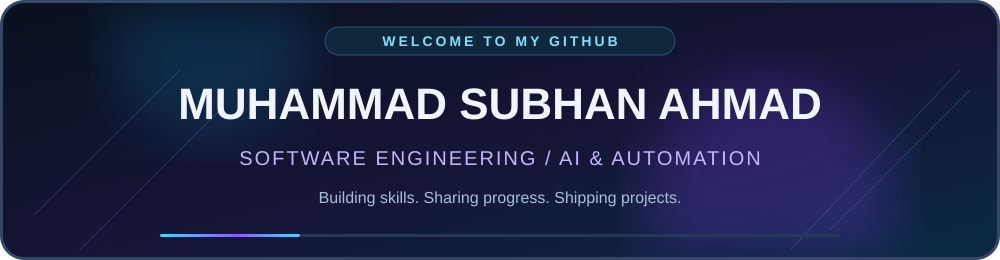
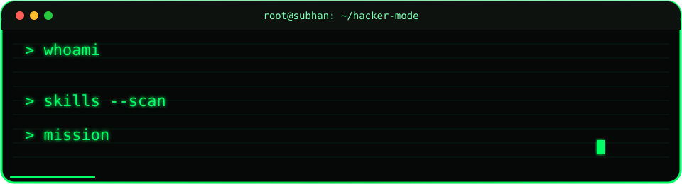
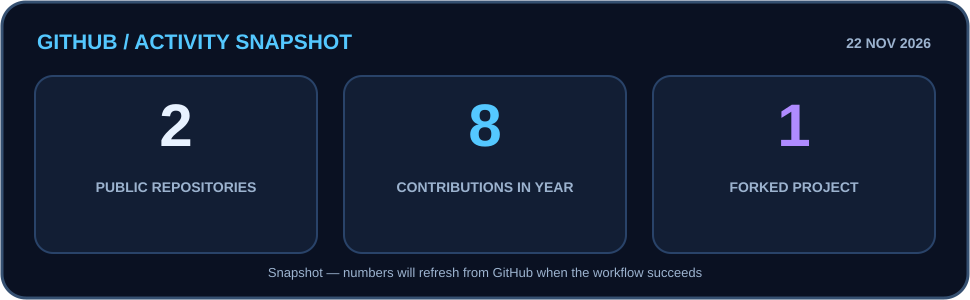
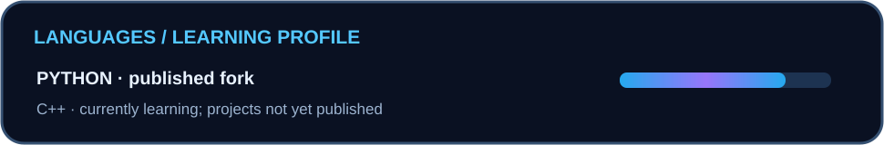
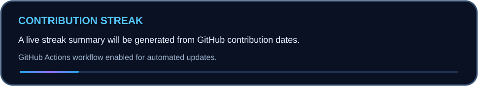
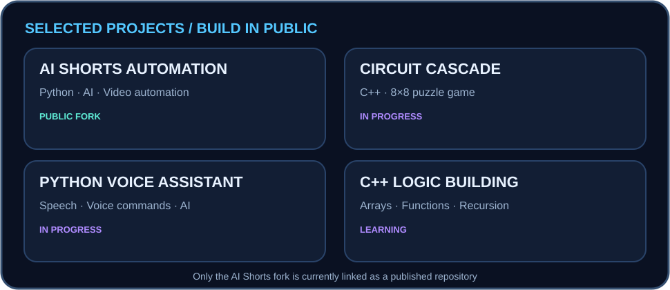

 

 

---

### 🖥️ 01 / Coding Terminal Animation

### 👋 02 / About Me

- 🎓 **BS Software Engineering** student at **FAST-NUCES (Chiniot–Faisalabad Campus)**
- 💻 Currently practising **C++**, **Python** and problem solving
- 🤖 Interested in **AI assistants**, **automation**, and practical software projects
- 📍 Based in Pakistan

### ⚡ 03 / Animated Skills & Technologies

 

These are technologies I use or am currently learning, not a claim of advanced proficiency.

### 📊 04 / GitHub Statistics Dashboard

**Live GitHub statistics (external service; may sometimes be unavailable):**

**Contribution streak:** The visual card below links to your live contribution history.

The self-hosted snapshot is dated November 22, 2026 and is not a live counter. Languages reflect published repositories and your documented learning interests; they are not language usage percentages.

### 🚀 05 / Featured Projects Showcase

**Published project:** [AI Shorts Automation — open-source fork](https://github.com/subhan-342100/purffle-shorts)

**In progress:** Circuit Cascade (C++ game), Python Voice Assistant, and C++ Logic Building exercises. These are listed as work in progress rather than published repositories.

### 🐍 06 / Contribution Snake Animation

<picture>
<source media="(prefers-color-scheme: dark)" srcset="https://raw.githubusercontent.com/subhan-342100/subhan-342100/output/github-snake-dark.svg">
<source media="(prefers-color-scheme: light)" srcset="https://raw.githubusercontent.com/subhan-342100/subhan-342100/output/github-snake.svg">

</picture>

### 🌐 07 / Connect

 

<b>Building skills · Shipping projects · Improving every day</b>

