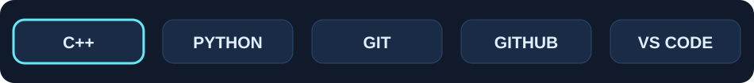

 

 

---

### 💻 About Me — Terminal Mode

- 🎓 Studying **BS Software Engineering at FAST-NUCES, Chiniot–Faisalabad Campus**
- 🧩 Building fundamentals in **C++**, **Python**, algorithms and problem solving
- 🤖 Interested in **voice assistants**, **AI automation** and useful software
- 🌍 Based in **Pakistan**

### 🛠️ Tech Stack — Learning & Building

 

> My tech stack shows what I'm learning and using — not a claim of expert proficiency.

### 📊 GitHub Statistics Dashboard

*Third-party stat cards may occasionally be unavailable due to their service limits.*

### 🚀 Featured Projects & Experiments

<table>
<tr><td width="50%">

#### 🎬 [AI Shorts Automation](https://github.com/subhan-342100/purffle-shorts)

Exploring AI-assisted video generation through a **forked open-source Python project**.

**Status:** Experimenting · Repository available

</td><td width="50%">

#### 🎮 Circuit Cascade

Developing an **8×8 C++ puzzle game** for Programming Fundamentals.

**Status:** Work in progress · Not yet published here

</td></tr>
<tr><td width="50%">

#### 🎙️ Python Voice Assistant

Learning speech recognition, voice commands and conversational assistant workflows.

**Status:** Work in progress · Not yet published here

</td><td width="50%">

#### 📚 C++ Logic Building

Practising arrays, functions, recursion, conditions and problem-solving.

**Status:** Learning journey · More projects to come

</td></tr>
</table>

### 🐍 GitHub Contribution Snake

<picture>
  <source media="(prefers-color-scheme: dark)" srcset="https://raw.githubusercontent.com/subhan-342100/subhan-342100/output/github-snake-dark.svg" />
  <source media="(prefers-color-scheme: light)" srcset="https://raw.githubusercontent.com/subhan-342100/subhan-342100/output/github-snake.svg" />
  
</picture>

---

**Building skills · Sharing progress · Improving every day**

